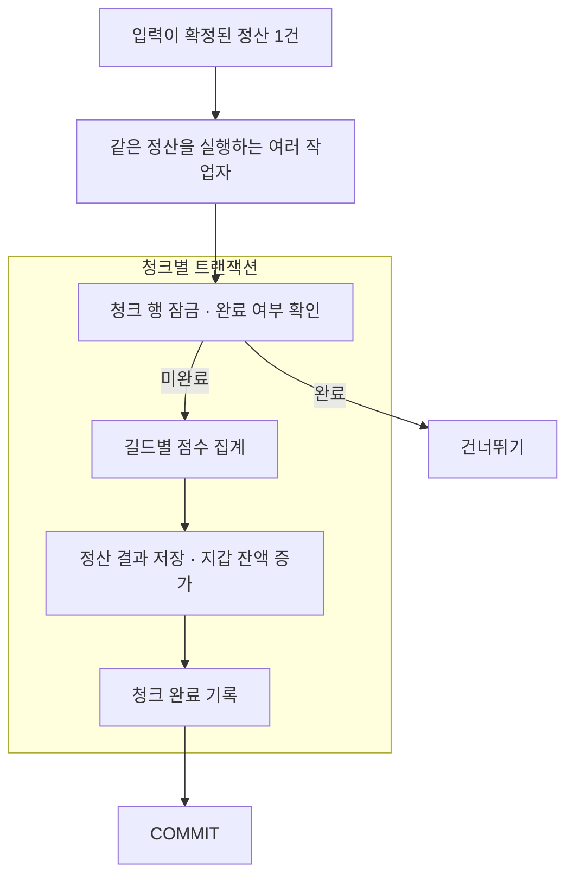

# promo-lab

PostgreSQL의 점수 갱신 경쟁과 정산 배치를 다룬 개인 DBA 포트폴리오입니다. 중복 지급을 막는 트랜잭션부터 실행계획, 잠금, VACUUM, 백업·복원까지 직접 실행한 결과를 기록했습니다.

## 실험 배경

실무에서 유저별 점수를 저장하면서 길드 공용 score도 갱신했던 경험에서 출발했습니다. 한 길드의 최대 40명이 같은 점수 행을 갱신하면 얼마나 기다리는지, 요청을 모아 반영하면 어떤 차이가 생기는지 확인했습니다.

당시 코드의 정확한 트랜잭션 범위와 갱신 방식은 확인되지 않았습니다. 점수 갱신 실험은 유저·길드 점수에 증가분을 더하는 방식으로 가정했습니다. 정산은 별도로 준비한 score_event의 입력을 확정한 뒤 처리하며, 실무 시스템을 그대로 재현한 프로젝트는 아닙니다.

## 정산 처리 구조



작업자는 같은 청크 목록을 번호순으로 읽습니다. 같은 청크의 잠금을 기다린 작업자는 잠금을 얻은 뒤 완료 여부를 다시 확인합니다. 작업자 2·4·8개 실행은 중복 실행의 안전성을 확인한 실험이며, 청크를 미리 나눠 맡기는 병렬 처리 성능 실험은 아닙니다.

테이블 구조와 FK를 두지 않은 이유는 [정산 구조](docs/schema-decisions.md), 제약과 작업자 권한은 [schema.sql](sql/schema.sql) 주석에 정리했습니다.

## 성능 비교에서 확인한 차이

아래 수치는 조건별 워밍업 1회 후 측정 5회의 중앙값입니다. 서로 다른 실험의 수치를 직접 비교하지 않습니다.

| 비교 | 관측 결과 | 선택할 때 고려할 점 |
|---|---|---|
| [길드 점수 즉시 갱신 → 지연 합산](docs/score-batching.md) · 40명, 2,000회 요청 | 요청 p95 275.1 → 57.2ms · 길드 UPDATE 2,000 → 21회 | 응답 이후 반영 확인 p95 140.0ms 추가 · 미반영 내역 INSERT·DELETE 비용 |
| [집계 인덱스](docs/indexes.md) · 이벤트 100만 건 중 길드 100개의 점수 집계 | PK만 유지 28.39ms · 복합 2.67ms · 커버링 0.65ms | 보조 인덱스 크기 복합 9.63MiB · 커버링 50.07MiB |
| [청크당 길드 수](docs/chunks.md) · 길드 10만 개, 이벤트 100만 개 | 1,000개씩 처리 14.78초 · 10,000개씩 처리 15.23초 | 첫 지갑 잠금 요청 완료 138.16 → 1,410.26ms · 순수 잠금 대기시간과 구분 |

지연 합산은 응답 시점에 유저 점수의 증가분이 길드 점수에 아직 반영되지 않을 수 있습니다. 두 점수의 반영 시점이 같아야 한다면 적용할 수 없는 방식입니다. 커버링 인덱스는 이번 조회에서 빨랐지만 공간과 쓰기 비용을 함께 봐야 합니다. 청크 1,000개와 10,000개의 처리시간 범위는 겹치므로, 속도 우열보다 잠금 유지시간을 보고 1,000개 단위를 후속 비교 후보로 삼았습니다.

## 실패와 복구 확인

| 실험 | 확인한 결과 |
|---|---|
| [같은 정산의 중복 실행](docs/duplicate-execution.md) | 작업자 2·4·8개에서 정산 결과·지갑 잔액 일치 · 완료 후 재실행에도 변경 없음 |
| [작업자 강제 종료](docs/termination.md) | 첫 청크 커밋 전 롤백 · 커밋 직후 완료 기록 유지 · 재실행 후 예상값 일치 |
| [락 시간 초과·데드락](docs/locking.md) | SQLSTATE 55P03·40P01 발생 후 각각 1회 재시도 · 최종 결과 일치 |
| [긴 스냅샷과 VACUUM](docs/vacuum.md) | 스냅샷 유지 중 정리되지 않은 이전 행 버전 30만 개 · 종료 후 VACUUM으로 제거 · Heap Fetches 400 → 0 |
| [백업·복원](docs/backup-restore.md) | 별도 DB에서 6개 테이블의 데이터·정의·객체 권한 일치 · 정산 재실행 시 중복 지급 없음 |

정산 결과는 DB에 넣기 전에 Python에서 계산한 예상값과 비교합니다. 결과 해시뿐 아니라 길드별 점수·보상·잔액, 입력과 청크 목록도 확인합니다. 반복별 수치·실행계획·서버 로그 등 비교 근거는 [experiments](experiments)에, 요청별 원본과 백업 파일은 로컬 results 폴더에 보관합니다.

## 직접 실행

Windows PowerShell과 Docker Desktop의 Linux 컨테이너 모드를 기준으로 합니다. Python을 PC에 따로 설치할 필요는 없습니다. 아래 prepare 명령은 데이터와 예상값 파일이 없는 첫 실행용입니다.

```powershell
docker compose up -d --wait db
docker compose run --rm --build runner doctor
docker compose run --rm runner prepare
docker compose run --rm runner settle
docker compose run --rm runner verify
```

기본 데이터는 길드 100개·이벤트 10,000건이며, 기록은 results/job-1에 저장합니다. DB 접속, 재실행, 개별 실험 명령과 초기화 방법은 [실행 안내](docs/runbook.md)에 정리했습니다.

## 환경과 남은 범위

PostgreSQL 18.6·Python 3.13.7·psycopg 3.3.6을 사용하며 DB 컨테이너는 CPU 2개·RAM 2GiB로 제한했습니다. 이미지 digest와 의존성 버전을 고정했습니다. [환경 기록](experiments/chunks-host.json)에 PC와 Docker 사양을 남겼습니다.

단일 PC의 실험 결과이며 운영 성능을 보장하지 않습니다. 점수 갱신과 확정 입력의 정산은 별도 실험입니다. 처리 완료 후 같은 점수 요청이 다시 들어오는 경우의 중복 방지, 연결 종료 후 COMMIT 성공 여부 확인, 다른 서버로의 복원과 특정 시점 복구는 남은 범위입니다.
