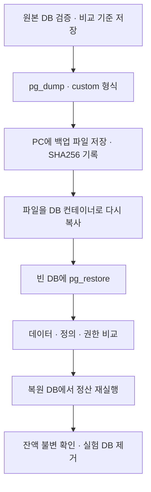

# 정산 데이터 백업과 복원

2026-10-16 · PostgreSQL 18.6 · 길드 100개 · 이벤트 10,000건

정산이 완료된 DB를 파일로 백업하고, 그 파일을 별도 DB에 복원했습니다. 복원 성공 여부만 보지 않고 데이터·테이블 정의·권한을 원본과 비교한 뒤 정산을 다시 실행했습니다.



## 실행 결과

| 항목 | 결과 |
|---|---|
| 백업 파일 | 69,417 bytes · custom 형식 · gzip 압축 |
| 백업 | 0.86초 |
| 복원 | 0.80초 |
| 비교·권한 확인·재실행 | 3.01초 |
| 데이터 비교 | 6개 테이블의 행 수·전체 컬럼 해시 일치 |
| 정의·권한 비교 | 컬럼·기본값·제약·인덱스·소유자·테이블 및 컬럼 ACL·public 스키마 ACL·확장 버전 일치 |
| 정산 재실행 | 처리 0개 · 완료 청크 10개 건너뛰기 · 잔액 및 완료 시각 불변 |

원본의 정산 결과와 지갑 잔액은 준비 단계에서 계산한 예상값과도 일치했습니다. 복원 후 작업자 계정으로 허용된 쓰기 3종과 금지된 쓰기 3종을 확인했습니다. 금지한 입력 수정·결과 삭제·청크 범위 수정은 모두 권한 오류로 거부됐습니다. 허용 확인은 실제 행을 변경하지 않는 SQL로 실행했습니다.

## 백업과 복원 기준

`pg_dump -Fc`로 파일 하나에 저장하고 `pg_restore`로 복원했습니다. 소유자와 객체 권한을 복원하기 위해 `--no-owner`·`--no-acl`은 사용하지 않았습니다. 복원은 `--exit-on-error --single-transaction`으로 실행해 오류가 나면 중단하고 복원 트랜잭션을 롤백하도록 했습니다. [pg_dump 문서](https://www.postgresql.org/docs/18/app-pgdump.html) · [pg_restore 문서](https://www.postgresql.org/docs/18/app-pgrestore.html)

백업 파일은 PC에 저장한 뒤 컨테이너의 다른 경로로 다시 복사해 사용했습니다. 성공·실패 여부와 관계없이 로컬 파일과 로그를 남기고, 이 실행에서 만든 복원 DB와 컨테이너 임시 파일만 제거합니다.

이번 복원은 같은 서버에 있는 기존 lab_admin·lab_worker 계정을 사용했습니다. `pg_dump`는 역할 같은 서버 공통 객체를 백업하지 않으므로, 새 서버에 계정까지 복구한 실험은 아닙니다. DB 자체의 접속 권한·DB별 설정 복원도 이번 비교에서 제외했습니다. [pg_dump 백업 범위](https://www.postgresql.org/docs/18/app-pgdump.html)

시간은 한 번 실행한 관측값이며 Docker 명령 호출 비용을 포함합니다. 백업 시간에는 PC로 파일을 복사하는 시간이, 복원 시간에는 빈 DB 생성과 검증 시간이 포함되지 않습니다. 이 수치를 서비스의 장애 복구 시간으로 사용하지 않습니다.

실험 중 원본에 쓰기 작업을 실행하지 않았으며 백업 전후 원본도 같은지 확인했습니다. 쓰기가 계속되는 상황의 백업, 다른 서버로의 복원, 파일 손상·복원 중단, WAL을 이용한 특정 시점 복구는 시험하지 않았습니다.

## 재현

기존 정산 완료 데이터와 results/job-1/expected.json이 필요합니다. DB를 실행하고 runner 이미지를 준비한 뒤 저장소 루트의 PowerShell에서 실행합니다.

```powershell
.\scripts\backup-restore.ps1
```

원본 DB는 settlement_lab로 고정이며, 복원 대상은 실행마다 새로운 UUID 이름입니다. 기록은 results/backup-*에 저장합니다. [실행 스크립트](../scripts/backup-restore.ps1)와 [복원 확인 코드](../runner/backup.py)에 처리 순서를 정리했습니다.

기록: [결과 JSON](../experiments/backup-restore.json) · [백업 전 정의·권한·데이터 해시](../experiments/backup-source-snapshot.json) · [백업 파일 목록](../experiments/backup-archive-list.txt) · [도구 버전](../experiments/backup-tool-versions.txt)
