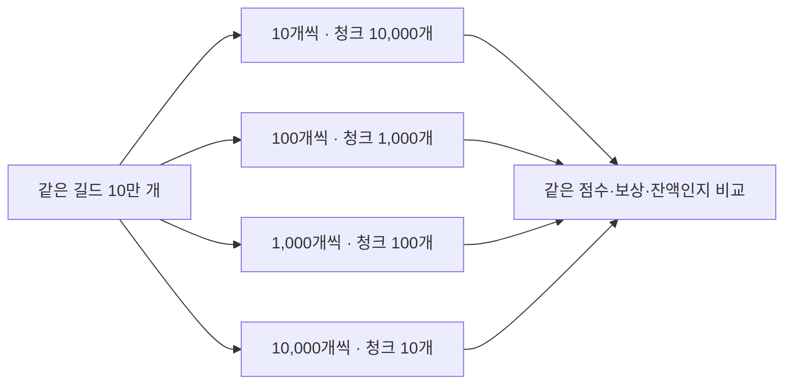

# 청크 크기와 잠금 유지

2026-10-15 · 길드 10만 개 · 이벤트 100만 개 · seed 42

같은 입력을 10·100·1,000·10,000개 길드 단위로 정산합니다. 작은 청크는 커밋 횟수가 늘고, 큰 청크는 먼저 갱신한 지갑의 잠금을 더 오래 유지할 수 있습니다.

## 비교 조건

정산 작업자 1개와 잠금 확인용 연결 1개를 사용합니다. 첫 지갑이 갱신되면 확인용 연결이 같은 지갑의 잠금을 요청합니다. 이 요청이 완료되는 시간과 DB에서 관측한 대기 상태를 기록합니다. 요청 완료시간에는 SQL 실행과 통신 비용도 포함하므로 순수 잠금 대기시간은 아닙니다.

확인용 연결의 lock_timeout은 30초로 설정했습니다. 잠금 관측은 조회 후 20ms를 기다리며 반복합니다. 짧은 대기가 수집 사이에 끝나면 기록되지 않을 수 있습니다.

각 크기에서 워밍업 1회 후 5회 측정하며 실행 순서를 번갈았습니다. 매번 결과·잔액·청크 완료 기록을 초기화하고, 길드와 입력 이벤트는 유지합니다. 모든 경우에 같은 커버링 인덱스를 사용하며 입력 적재 후 VACUUM (ANALYZE)를 실행합니다.

정산 SQL과 트랜잭션 경계는 같습니다. 길드마다 응답을 기다리는 비용을 줄이도록 INSERT·UPDATE를 pipeline으로 전송합니다. 전송 방식 변경 후 기존 롤백·재시도·중복 실행·프로세스 종료 확인도 다시 통과했습니다.

청크 지연은 잠금 요청부터 커밋 완료까지입니다. 전체 처리시간에는 정산 완료 표시를 포함하고, 데이터 준비·초기화·결과 비교 시간은 제외합니다. 모든 실행에서 길드별 점수·보상·잔액과 전체 입력을 별도 예상값과 비교합니다.

크기별로 결과·잔액 해시가 같은지 확인합니다. 청크 목록과 완료 시각은 실행마다 달라지므로 전체 데이터 해시는 크기 사이의 비교에 사용하지 않습니다.

측정 중 SQL 오류가 나면 해당 실험을 실패로 처리합니다. 이 실험은 재시도 비용이 아니라 청크 크기에 따른 처리·잠금 유지 비용을 비교합니다.

## 측정 결과

각 수치는 측정 5회의 중앙값입니다. 청크 p95는 각 실행에서 청크별 처리시간을 정렬했을 때 95% 지점의 값입니다.

| 청크당 길드 | 청크 수 | 전체 처리시간 | 청크 p95 | 첫 지갑 요청 완료시간 |
|---|---|---|---|---|
| 10개 | 10,000개 | 51.40초 | 6.26ms | 6.95ms |
| 100개 | 1,000개 | 17.52초 | 21.96ms | 18.12ms |
| 1,000개 | 100개 | 14.78초 | 188.92ms | 138.16ms |
| 10,000개 | 10개 | 15.23초 | 1,738.03ms | 1,410.26ms |

워밍업을 포함한 24회 모두 점수·보상·잔액이 예상값과 일치했습니다. 크기가 달라도 결과·잔액 해시는 같았습니다.

1,000개와 10,000개 단위의 전체 처리시간 범위는 각각 12.21~15.67초, 11.70~16.30초로 겹칩니다. 속도 차이를 확정하기는 어렵지만, 10,000개에서는 첫 지갑을 기다리는 시간이 훨씬 길었습니다. 후속 성능 비교에서는 1,000개 단위를 후보로 삼겠습니다. 운영 기본값을 확정한 것은 아닙니다.

10,000개 단위는 실행당 청크가 10개뿐이어서 이번 계산의 p95와 p99가 모두 최대값입니다. 드문 지연의 분포를 설명하기에는 표본이 부족합니다. 10개 단위는 잠금 대기 표본이 수집되지 않았지만, 요청 완료시간은 기록됐습니다. 대기를 관측하지 못한 것을 대기가 전혀 없었다는 뜻으로 해석하지 않습니다.

SQL 전송 방식 변경 전의 예비 실행은 비교에서 제외했습니다. 위 수치는 모두 pipeline을 사용한 같은 코드에서 나온 결과입니다. 기존 단일 정산 데이터도 변경되지 않은 것을 확인했습니다.

환경은 PostgreSQL 18.6·psycopg 3.3.6, DB 제한 CPU 2개·RAM 2GiB입니다. 캐시를 비우지 않은 단일 PC 실험이며, 점수가 계속 들어오는 운영 환경은 포함하지 않았습니다.

기록: [결과 JSON](../experiments/chunks.json) · [반복별 CSV](../experiments/chunks-runs.csv) · [환경](../experiments/chunks-host.json) · [전송 방식 변경 후 기존 기능 확인](../experiments/chunks-regression.json)

청크별 지연 CSV와 잠금 관측 원본은 results/chunks-* 폴더에 남깁니다.
