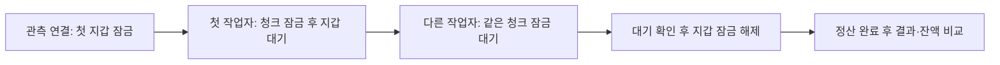

# 같은 정산의 중복 실행

2026-10-14 · seed 42 · 길드 100개 · 이벤트 1만 개 · 청크 10개

별도 실험 DB에서 Python 작업자 2·4·8개로 같은 정산을 실행했습니다. 기존 DB는 변경하지 않았으며, 실험 DB는 결과 확인 후 제거했습니다.

첫 작업자가 청크 잠금을 유지하도록 관측 연결에서 첫 지갑을 잠갔습니다. 모든 작업자의 대기와 작업자 사이의 차단 관계를 pg_stat_activity·pg_blocking_pids()로 확인한 뒤 지갑 잠금을 해제했습니다.

| 작업자 수 | 처리한 청크 합계 | 건너뛴 청크 합계 | 결과·잔액 비교 | 재실행 후 변경 |
|---|---|---|---|---|
| 2 | 10 | 10 | 일치 | 없음 |
| 4 | 10 | 30 | 일치 | 없음 |
| 8 | 10 | 70 | 일치 | 없음 |

각 실행에서 모든 작업자는 정상 종료했고, 재시도는 0회였습니다. 길드별 점수·보상·잔액을 예상값과 비교했으며, 다시 실행한 뒤 완료 시각을 포함한 전체 데이터 해시가 같은 것도 확인했습니다.

이 결과는 작은 데이터에서의 중복 실행 확인입니다. 잠금 대기를 관측하기 위해 지갑을 잠근 조건이므로 성능 측정값으로 사용하지 않습니다. 작업자가 모두 대기한 순간의 기록이며, 모든 잠금의 전체 이력을 수집한 것은 아닙니다.

결과 JSON: [2개](../experiments/duplicate-2.json) · [4개](../experiments/duplicate-4.json) · [8개](../experiments/duplicate-8.json)

각 JSON의 lock_observation 행은 `[pid, 작업자 이름, 대기 종류, 대기 대상, 차단한 pid 목록]` 순서입니다. 전체 예상값·작업자별 로그·실행 기록은 각 실행의 results/duplicate-* 폴더에 남깁니다.
