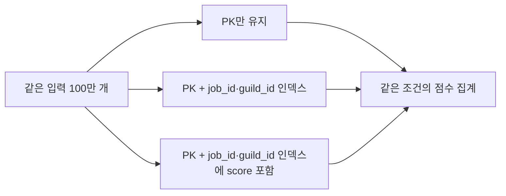

# 점수 집계 인덱스 비교

2026-10-14 · seed 42 · 길드 1만 개 · 정산 4개 · 구성별 이벤트 100만 개

같은 CSV를 세 테이블에 적재하고, job 1의 길드 1~100 점수를 집계했습니다. 조건에 맞는 이벤트는 2,552개이며 결과는 길드 100개입니다. 테이블 구조와 쿼리는 같고 인덱스 구성만 다릅니다.

## 읽기와 적재 비용

| 구성 | 조회시간 중앙값 | 실행계획의 읽기 방식 | 보조 인덱스 크기 | 적재시간 |
|---|---|---|---|---|
| PK만 유지 | 28.39ms | Parallel Seq Scan | 없음 | 1.21초 |
| (job_id, guild_id) | 2.67ms | Bitmap Heap / Index Scan | 9.63MiB | 2.87초 |
| 같은 키 + INCLUDE(score) | 0.65ms | Index Only Scan | 50.07MiB | 3.28초 |

조회시간은 워밍업 1회 후 5회 측정의 중앙값입니다. 실행 순서를 번갈았고, 모든 결과를 Python에서 별도로 계산한 예상값과 비교했습니다. 적재시간은 인덱스를 미리 만든 상태에서 COPY·COMMIT까지 1회 측정한 참고값입니다. 반복한 조회시간과 같은 수준의 성능 근거로 사용하지 않습니다.

PK만 있는 조회의 측정 범위는 25.60~59.64ms, 복합 인덱스는 2.13~2.96ms, 커버링 인덱스는 0.59~0.73ms였습니다. 반복별 원본을 함께 남겼습니다.

## 실행계획에서 확인한 차이

PK만 있을 때는 전체 테이블을 병렬로 읽고 조건에 맞는 행을 골랐습니다. 복합 인덱스를 추가하자 대상 위치를 찾은 뒤 테이블에서 score를 읽는 방식으로 바뀌었습니다.

score까지 포함한 인덱스에서는 테이블을 다시 읽지 않고 집계했으며 Heap Fetches는 0이었습니다. 세 테이블 모두 적재 후 VACUUM (ANALYZE)를 실행한 조건입니다. 자주 갱신되는 데이터에서도 같은 결과가 나온다는 뜻은 아닙니다. [PostgreSQL Index Only Scan 문서](https://www.postgresql.org/docs/18/indexes-index-only-scans.html)

EXPLAIN 계측은 조회시간 측정과 분리했습니다. 루트 노드의 shared hit/read 블록은 각각 PK 2,024/5,412, 복합 2,203/0, 커버링 21/0이었습니다. read는 공유 버퍼 밖에서 읽은 횟수이며, 디스크의 실제 읽기 횟수로 단정하지 않습니다.

집계 결과의 추정 행 수는 2,061~2,265개였지만 실제 결과는 100개였습니다. 실행계획의 추정치와 실제값도 기록했으며, 인덱스 효과와 별개로 통계 추정의 오차가 남아 있습니다.

## 선택할 때 고려할 점

이번 범위 집계에서는 커버링 인덱스가 가장 빨랐지만 공간과 적재 비용도 더 컸습니다. INCLUDE 인덱스는 같은 키의 중복을 묶는 B-tree 최적화를 사용하지 못하므로, 크기 차이를 score 컬럼 하나의 크기만으로 설명하면 안 됩니다. [PostgreSQL B-tree 문서](https://www.postgresql.org/docs/18/btree.html#BTREE-DEDUPLICATION)

따라서 현재 결과만으로 운영 인덱스를 확정하지 않습니다. 실제 집계 범위, 점수 갱신 빈도, 적재량을 함께 봐야 합니다. 공용 길드 score의 행 잠금 경쟁은 별도 쓰기 실험의 문제이며 이 인덱스로 해결됐다고 표현하지 않습니다.

환경은 PostgreSQL 18.6, DB 제한 CPU 2개·RAM 2GiB입니다. 캐시를 비우지 않은 반복 조회이며 세 테이블 전체가 공유 버퍼에 상주한다고 보장하지 않습니다. 기존 DB는 유지하고 실험 DB만 종료 후 제거했습니다.

기록: [결과 JSON](../experiments/indexes.json) · [측정 CSV](../experiments/indexes-measurements.csv) · [PK 실행계획](../experiments/indexes-baseline-plan.json) · [복합 실행계획](../experiments/indexes-composite-plan.json) · [커버링 실행계획](../experiments/indexes-covering-plan.json)

집계 SQL은 [aggregate_scores.sql](../sql/aggregate_scores.sql), PC·컨테이너 사양은 [환경 기록](../experiments/score-updates-host.json)에 있습니다. 입력 CSV와 예상값은 results/indexes-* 폴더에 남깁니다.

갱신이 있는 조건은 [긴 스냅샷과 VACUUM 실험](vacuum.md)에서 추가로 확인했습니다. 같은 Index Only Scan에서도 Heap Fetches가 달랐습니다.
