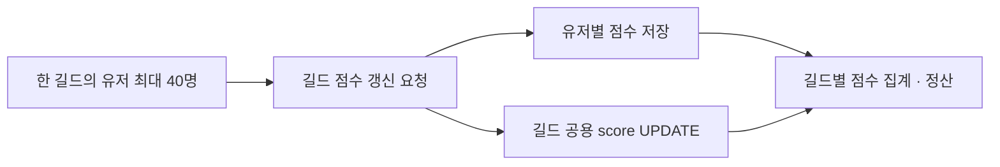
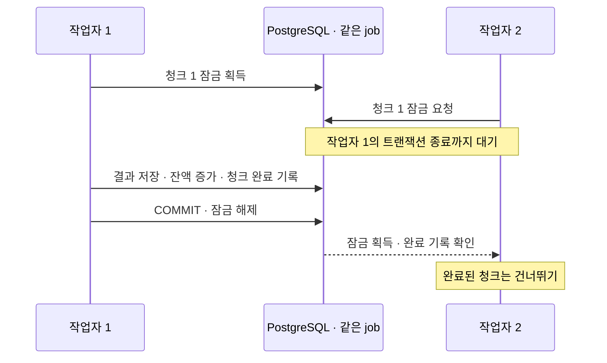
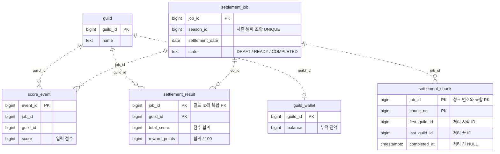
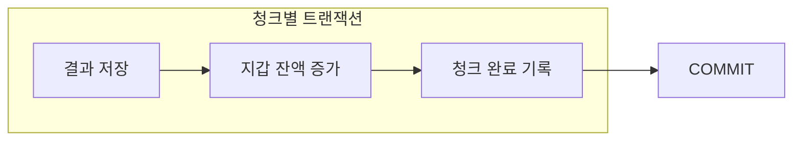

# 정산 구조

## 실무에서 출발한 고민

당시에는 유저별 점수를 저장하면서 길드 공용 score도 UPDATE했던 것으로 기억합니다. 길드당 최대 40명의 갱신 요청이 같은 길드에 몰렸을 때 지연될 수 있다는 우려가 있었습니다. 이 실험은 당시의 고민을 출발점으로 삼은 개인 실험입니다.

확인할 문제는 점수를 기록할 때의 경쟁과, 기록된 점수를 정산할 때의 집계 비용입니다. 40명이라는 인원만으로 동시 요청 수나 갱신 빈도를 단정하지는 않습니다.

정산 실험은 score_event에 미리 넣은 점수를 확정한 뒤 처리합니다. 유저별 점수와 길드 공용 score를 함께 갱신하는 상황은 [별도 점수 갱신 실험](score-updates.md)에서 확인했습니다. 집계용 인덱스 비교와 같은 길드 행을 갱신할 때의 경쟁은 구분합니다.

실무 코드의 두 쓰기가 같은 트랜잭션이었는지, score에 증가분을 더했는지 계산한 값을 덮어썼는지는 아직 확인되지 않았습니다. 점수 갱신 실험은 같은 트랜잭션에서 증가분을 더하는 방식으로 가정했습니다.

## 정산과 작업자

정산(job)은 특정 시즌·날짜에 처리할 작업 1건입니다. 청크는 대상 길드를 나눈 처리 단위이며, 작업자는 정산 프로그램을 실행하는 프로세스입니다. 여러 작업자가 같은 job을 처리하며, 별도의 정산 담당 프로세스는 두지 않습니다.

현재 작업자는 같은 청크 목록을 번호순으로 읽습니다. 청크를 미리 나눠 배정하지 않고, DB의 행 잠금과 완료 기록으로 중복 처리를 막는 방식입니다. 이는 병렬 분담이 아니라 같은 정산이 중복 실행되는 상황을 확인하는 실험입니다. [작업자 2·4·8개 실행 결과](duplicate-execution.md)를 기록했습니다.

서로 다른 청크는 동시에 처리할 수 있습니다. 같은 청크는 먼저 잠금을 잡은 작업자가 처리하고, 기다린 작업자는 잠금을 얻은 뒤 완료 여부를 다시 확인합니다. 앞선 처리가 롤백돼 완료 기록이 없다면 기다린 작업자가 처리합니다.

## 테이블 관계

점선은 ID로 연결되는 논리적 관계입니다. 실제 FK는 없으며, 주요 컬럼만 표시했습니다.

## 청크 처리

청크 행을 잠근 뒤 완료 여부를 확인합니다. 미완료 청크는 아래 세 변경을 하나의 트랜잭션으로 처리합니다.

제약과 권한의 이유는 [schema.sql](../sql/schema.sql) 주석에 정리했습니다. 단일 정산·재실행·동시 중복 실행, [작업자 종료 후 재실행](termination.md), [락 시간 초과·데드락 재시도](locking.md)를 확인했습니다.

전체 길드 수를 10만 개로 늘린 [청크 크기 비교](chunks.md)에서는 처리시간과 첫 지갑의 잠금 요청 완료시간을 함께 기록했습니다.

[긴 스냅샷과 VACUUM 실험](vacuum.md)에서는 읽기 트랜잭션을 유지했을 때 이전 행 버전의 정리와 Heap Fetches가 어떻게 달라지는지 확인했습니다.
