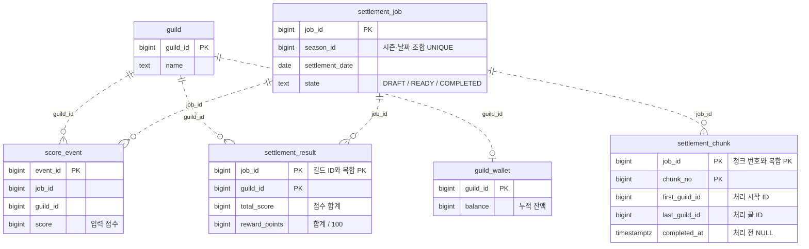
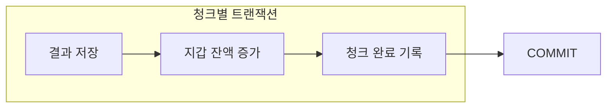

# 정산 테이블 구조

점선은 ID로 연결되는 논리적 관계입니다. 실제 FK는 없으며, 주요 컬럼만 표시했습니다.

청크 행을 잠근 뒤 완료 여부를 확인합니다. 미완료 청크는 아래 세 변경을 하나의 트랜잭션으로 처리합니다.

제약과 권한의 이유는 [schema.sql](../sql/schema.sql) 주석에 정리했습니다. 단일 정산과 재실행 결과를 확인했으며, 동시 실행과 프로세스 종료 실험은 다음 단계입니다.
