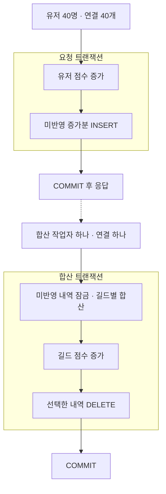

# 길드 공용 점수의 즉시 갱신과 지연 합산

2026-10-16 · 한 길드에 유저 40명 · 유저당 50회 · 총 2,000회

[기존 실험](score-updates.md)에서 확인한 공용 점수 행의 경쟁을 줄이려고, 요청마다 갱신하던 길드 점수를 모아서 반영했습니다. 유저 점수는 요청 시점에 저장하고, 길드 점수만 늦게 반영하는 방식입니다. 두 점수가 응답 시점에 반드시 일치해야 한다면 사용할 수 없는 구성입니다.

## 처리 방식

미반영 내역은 DB에 남깁니다. 길드 점수 갱신과 내역 삭제를 같은 트랜잭션으로 묶어, 커밋 전 실패하면 둘 다 롤백되도록 했습니다. 메모리에만 모으는 방식은 이번 비교에서 제외했습니다.

작업자는 매번 50ms를 기다린 뒤 최대 10,000건을 읽습니다. 처리시간이 더해지므로 정확한 50ms 주기도, 50ms 이내 반영 보장도 아닙니다. FK는 사용하지 않으며 실험 중 유저의 길드 소속과 길드 행은 고정입니다. 합산할 길드가 없으면 트랜잭션을 실패시키고 내역을 남깁니다.

## 측정 결과

두 방식에 같은 증가분을 사용했습니다. 연결 준비 후 동시에 시작하고, 워밍업 1회와 측정 5회를 방식별로 실행했습니다. 실행 순서는 번갈았으며 매번 데이터를 초기화했습니다. 아래 값은 측정 5회의 중앙값입니다.

| 항목 | 즉시 갱신 | 지연 합산 |
|---|---:|---:|
| 전체 요청 응답 완료 | 5.82초 | 2.12초 |
| 전체 길드 점수 반영 확인 | 5.82초 | 2.15초 |
| 초당 응답 완료 요청 | 344회 | 945회 |
| 요청 지연 p95 | 275.1ms | 57.2ms |
| 요청 시작부터 길드 반영 확인 p95 | 275.1ms | 185.1ms |
| 응답 이후 길드 반영 확인 p95 | 0ms | 140.0ms |
| 길드 점수 UPDATE | 2,000회 | 21회 |

같은 길드 행을 요청마다 갱신하지 않으면서 응답 지연이 줄었습니다. 다만 지연 합산에는 미반영 내역의 INSERT·DELETE가 요청 수만큼 추가됩니다. 길드 UPDATE가 줄었다는 이유로 전체 쓰기량도 줄었다고 판단하지 않습니다.

즉시 갱신은 응답 전에 두 점수가 함께 커밋됩니다. 지연 합산에서는 응답 후 잠시 길드 점수가 뒤처졌습니다. 이번 결과는 처리량과 점수 반영 시점의 차이를 함께 보여주는 자료입니다.

## 측정 기준과 확인 범위

요청 지연은 BEGIN부터 COMMIT 응답까지입니다. 길드 반영 시점은 즉시 갱신의 경우 요청 연결이, 지연 합산의 경우 합산 연결이 COMMIT 응답을 받은 시점입니다. 같은 프로세스의 단조 시계로 기록한 상한 관측값이며, 별도 조회 연결의 응답시간은 아닙니다. 합산 완료가 요청 연결의 응답 관측보다 빠르면 응답 이후 지연은 0으로 기록합니다.

총 12회 실행에서 모든 유저·길드 점수가 입력으로 계산한 예상값과 일치했습니다. 종료 시 미반영 내역은 0건이며, 두 방식과 모든 반복의 최종 점수 해시도 같았습니다. 커밋 전 예외로 합산을 실패시킨 뒤 내역과 길드 점수가 함께 롤백되는지, 새 연결에서 재처리한 뒤 다시 합산해도 점수가 늘지 않는지 확인했습니다. 유저당 1회만 요청하는 짧은 실행과 기존 정산 데이터 검증도 통과했습니다.

미반영 상태의 같은 요청 ID는 PK로 거부되며 유저 점수 증가도 롤백됩니다. 처리한 내역을 삭제한 뒤 같은 요청 ID가 다시 들어오는 경우까지 막지는 않습니다. 운영에 적용하려면 완료 요청 ID 보관 등 중복 요청 처리 기준이 필요합니다. 이번 실험은 예외·재연결을 확인했으며 프로세스 강제 종료와 DB 장애까지 시험하지 않았습니다.

환경은 PostgreSQL 18.6, psycopg 3.3.6, DB 제한 CPU 2개·RAM 2GiB입니다. 40명이 쉬지 않고 다음 요청을 보내는 작은 데이터 실험이며, 도착률을 고정한 운영 부하나 장시간 적체 조건은 포함하지 않았습니다. 합산 간격별 최적값, WAL 발생량과 잠금 대기시간은 측정하지 않았습니다.

기록: [결과 JSON](../experiments/score-batching.json) · [반복별 CSV](../experiments/score-batching-runs.csv) · [짧은 실행과 복구 확인](../experiments/score-batching-short.json) · [SQL·권한](../sql/score_batching.sql)

요청별 지연·합산별 요청 수·입력 증가분 원본은 results/score-batching-*에 저장합니다. 행 잠금을 위한 UPDATE 권한은 한 컬럼에만 부여했으며 실제 ID 갱신은 하지 않습니다. [PostgreSQL SELECT 권한 설명](https://www.postgresql.org/docs/18/sql-select.html)
