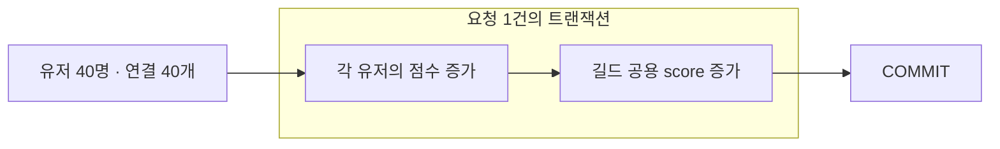

# 유저별 점수와 길드 공용 점수 갱신

2026-10-14 · 유저 40명 · 유저당 요청 50회 · 총 2,000회

유저별 점수를 저장하면서 길드 공용 score도 갱신했던 실무 경험을 바탕으로 한 개인 실험입니다. 당시의 정확한 구현은 확인되지 않아, 두 점수를 같은 트랜잭션에서 `score = score + 증가분`으로 갱신한다고 가정했습니다.

40명이 한 길드에 속한 경우와 네 길드에 10명씩 속한 경우를 비교했습니다. 증가분과 요청 수는 같고, 연결을 모두 준비한 뒤 동시에 시작했습니다. 워밍업 1회 후 각각 5회 측정했으며 실행 순서를 번갈았습니다. 매번 점수를 0으로 되돌렸습니다.

## 측정 결과

아래 값은 5회 측정의 중앙값입니다. p95는 각 실행의 요청별 처리시간을 짧은 순서로 정렬했을 때 95% 지점의 값입니다. 요청별 처리시간에는 BEGIN부터 COMMIT까지 포함합니다.

| 요청 분포 | 전체 처리시간 | 초당 요청 수 | 요청 지연 p95 | 관측한 최대 대기 연결 |
|---|---|---|---|---|
| 한 길드에 40명 | 5.40초 | 370회 | 261.9ms | 39개 |
| 네 길드에 10명씩 | 2.16초 | 926회 | 107.4ms | 36개 |

두 경우 모두 유저별 점수와 길드별 점수가 예상값과 일치했고, 재시도는 0회였습니다. 길드 갱신이 실패하면 먼저 실행한 유저 점수 증가도 롤백되는 것을 확인했습니다.

한 길드에 몰린 경우에는 같은 행을 갱신하려는 요청이 기다리는 것을 관측했습니다. 네 길드로 나누면 각 길드 안에서는 경쟁이 남지만, 서로 다른 길드의 갱신은 함께 진행할 수 있습니다. 이번 조건에서는 요청 집중이 점수 누락보다 지연으로 나타났습니다.

## 측정 범위

실험 전용 user_score·guild_score 테이블을 사용했으며 기존 정산 테이블은 변경하지 않았습니다. SQL과 권한은 [score_updates.sql](../sql/score_updates.sql)에 정리했습니다.

40개 연결이 쉬지 않고 요청한 부하 실험입니다. 길드원이 40명이라는 이유로 실제 서비스에서 항상 같은 부하가 발생한다는 뜻은 아닙니다. 점수 읽기 후 덮어쓰기, 재접속 후 중복 요청, 이벤트 집계 방식과의 비교는 포함하지 않았습니다.

잠금 대기는 조회 후 20ms를 기다리며 수집했습니다. 수집 사이에 발생한 대기는 놓칠 수 있으며, UPDATE 실행시간을 순수 잠금 대기시간으로 해석하지 않습니다. 데이터는 작고 캐시를 비우지 않았습니다.

환경은 PostgreSQL 18.6, psycopg 3.3.6, DB 제한 CPU 2개·RAM 2GiB입니다. PC는 Ryzen 5 5600X·RAM 약 32GiB이며, 세부 환경은 아래 기록에 남겼습니다. 단일 PC의 수치로 운영 성능을 주장하지 않습니다.

기록: [결과 JSON](../experiments/score-updates.json) · [반복별 CSV](../experiments/score-updates-runs.csv) · [PC·컨테이너 환경](../experiments/score-updates-host.json)

요청별 지연 CSV, 증가분, 예상 점수와 잠금 관측 원본은 results/score-updates-* 폴더에 저장합니다.
