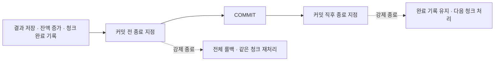

# 작업자 종료와 재실행

2026-10-14 · seed 42 · 길드 100개 · 이벤트 1만 개 · 청크 10개

별도 DB에서 첫 청크의 커밋 전·직후에 작업자를 멈춘 뒤 SIGKILL로 강제 종료했습니다. 종료 지점의 DB 트랜잭션 상태를 확인하고, 연결이 정리된 후 데이터와 잔액을 조회했습니다.

| 종료 지점 | 종료 후 결과 수 | 종료 후 완료 청크 | 재실행 처리 / 건너뛰기 | 최종 결과·잔액 |
|---|---|---|---|---|
| 커밋 전 | 0 | 0 | 10 / 0 | 예상값과 일치 |
| 커밋 직후 | 10 | 1 | 9 / 1 | 예상값과 일치 |

커밋 전에는 결과 저장·잔액 증가·청크 완료 기록까지 실행한 상태였습니다. 강제 종료 후 세 변경이 모두 롤백됐습니다.

커밋 직후에는 첫 청크의 결과와 완료 시각이 재실행 후에도 유지됐습니다. 나머지 청크를 처리한 뒤 예상값과 비교했으며, 한 번 더 실행해 전체 데이터 해시가 같은 것도 확인했습니다.

기존 DB는 변경하지 않았습니다. 실험 DB는 확인 후 제거하고, 종료 후 상태·예상값·로그는 각 results/termination-* 폴더에 남겼습니다.

결과 JSON: [커밋 전](../experiments/termination-before-commit.json) · [커밋 직후](../experiments/termination-after-commit.json)

이 실험은 클라이언트 프로세스 종료만 확인한 것입니다. DB 서버 종료나 네트워크 단절, COMMIT 응답을 받기 전 연결이 끊긴 상황은 아직 확인하지 않았습니다.
