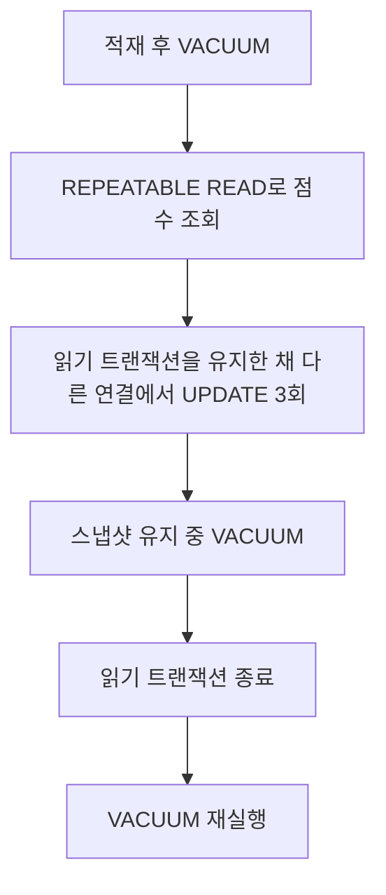

# 긴 스냅샷이 VACUUM에 미치는 영향

2026-10-15 · PostgreSQL 18.6 · 이벤트 10만 건

긴 트랜잭션이 이전 데이터를 계속 읽는 동안 VACUUM이 어디까지 정리할 수 있는지 확인했습니다. 별도 DB에 점수 이벤트와 커버링 인덱스를 만들고, 전체 점수를 세 번 갱신했습니다.

## 관측 결과

집계는 길드 1~10의 이벤트 100건을 대상으로 실행했습니다. 모든 단계에서 실제 테이블 행 수는 10만 건이며, 아래 크기는 인덱스를 제외한 테이블 파일 크기입니다.

| 단계 | dead tuple 추정치 | Heap Fetches | 테이블 크기 |
|---|---:|---:|---:|
| 적재 후 VACUUM | 0 | 0 | 6.00 MiB |
| UPDATE 3회, 스냅샷 유지 | 300,000 | 400 | 22.98 MiB |
| 스냅샷 유지 중 VACUUM | 300,000 | 400 | 22.98 MiB |
| 스냅샷 종료 후 VACUUM | 0 | 0 | 22.98 MiB |

스냅샷을 유지한 연결은 갱신 전 점수 합계를 계속 읽었습니다. 이때 VACUUM 로그에는 이전 행 버전 30만 개가 아직 제거 불가한 상태로 기록됐습니다. 읽기 트랜잭션을 끝낸 뒤에는 같은 수의 행 버전을 제거했습니다. 다른 트랜잭션이 읽을 수 있는 이전 버전은 유지해야 하기 때문입니다. [PostgreSQL VACUUM 문서](https://www.postgresql.org/docs/18/routine-vacuuming.html)

실행계획은 네 단계 모두 Index Only Scan이었지만 Heap Fetches는 달랐습니다. 커버링 인덱스가 있어도 행의 가시성을 테이블에서 확인해야 할 수 있습니다. 따라서 계획 이름과 함께 Heap Fetches를 확인해야 합니다. 400은 접근 횟수이며 서로 다른 행 400개라는 뜻은 아닙니다. [PostgreSQL Index Only Scan 문서](https://www.postgresql.org/docs/18/indexes-index-only-scans.html)

VACUUM 후 파일 크기가 유지된 것도 함께 기록했습니다. 일반 VACUUM은 정리한 공간을 재사용할 수 있게 하며, 보통 파일 자체를 줄이지는 않습니다. 이번 실험에서는 이후 쓰기로 공간이 재사용되는지까지 확인하지 않았습니다. [PostgreSQL 공간 회수 설명](https://www.postgresql.org/docs/18/routine-vacuuming.html#VACUUM-FOR-SPACE-RECOVERY)

## 확인 범위

`n_dead_tup`은 추정치입니다. 갱신 직후에는 `n_live_tup`도 20만으로 표시됐지만 실제 COUNT(*)는 10만이었습니다. 통계만으로 정확한 행 수나 공간 낭비 비율을 계산하지 않습니다.

수동 VACUUM의 영향을 구분하려고 실험 테이블에서만 autovacuum을 껐습니다. 전역 설정은 on이며 실험 중 자동 VACUUM 횟수는 0입니다. 테이블 설정은 종료 전에 복원했습니다. 이 조건으로 운영 autovacuum의 처리 속도를 판단하지 않습니다.

10만 건 전체의 점수와 집계값을 예상값과 비교했으며, 기존 정산 데이터의 검증도 통과했습니다. 실행계획은 단계별 한 번씩 기록한 관측 자료이며 속도 비교 자료로 사용하지 않습니다.

기록: [결과 JSON](../experiments/vacuum.json) · [초기 계획](../experiments/vacuum-initial-plan.json) · [갱신 직후 계획](../experiments/vacuum-updated_snapshot_held-plan.json) · [스냅샷 유지 중 계획](../experiments/vacuum-vacuum_snapshot_held-plan.json) · [종료 후 계획](../experiments/vacuum-vacuum_snapshot_released-plan.json) · [유지 중 VACUUM 로그](../experiments/vacuum-snapshot-held-log.json) · [종료 후 VACUUM 로그](../experiments/vacuum-snapshot-released-log.json)
